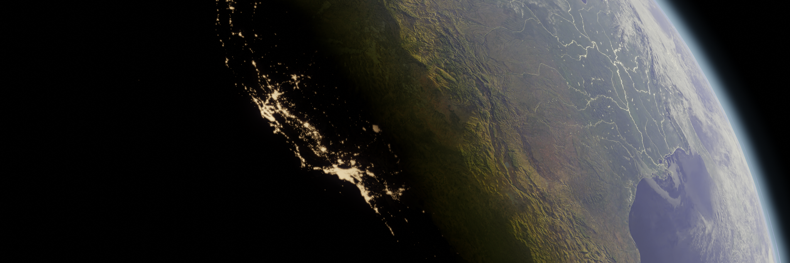

  

---

## Projets

<table>
  <tr>
    <td width="50%" align="center">
      <h3>01 · Spirale de Fibonacci</h3>
      
Modélisation géométrique et croissance de la spirale.

      <a href="./fibonnaci-spiral/"><b>Explorer le projet →</b></a>
    </td>
    <td width="50%" align="center">
      <h3>02 · Pendule</h3>
      
Modélisation et animation d'un système oscillant.

      <a href="./pandeleum-ball/"><b>Explorer le projet →</b></a>
    </td>
  </tr>
  <tr>
    <td colspan="2"> </td>
  </tr>
  <tr>
    <td width="50%" align="center">
      <h3>03 · Modélisation de la Terre</h3>
      
Reconstruction 3D à partir de données NASA.

      <a href="./Blender%20earth/"><b>Explorer le projet →</b></a>
    </td>
    <td width="50%" align="center">
      <h3>04 · Océan</h3>
      
Modélisation et animation de surfaces océaniques.

      <a href="./Ocean/"><b>Explorer le projet →</b></a>
    </td>
  </tr>
</table>

 

---
