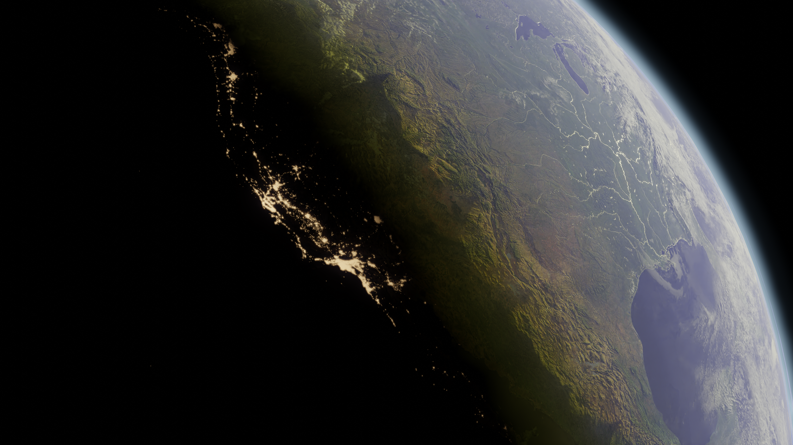

  

# Simulations 3D : Maths & Physique

Carnet d'expérimentations (2023) regroupant des projets de modélisation mathématique et physique réalisés sur Blender. 

## Projets inclus

* **Spirale de Fibonacci (`/fibonnaci-spiral`)** : Modélisation et animation de la croissance géométrique de la spirale.
* **Pendule (`/pandeleum-ball`)** :Animation d'un pendule.
* **Terrains & Océan (`/Blender earth`, `/Ocean`)** : Modèle 3D de la terre à partir de données en libres accès  (NASA) et animation de l'océan.

